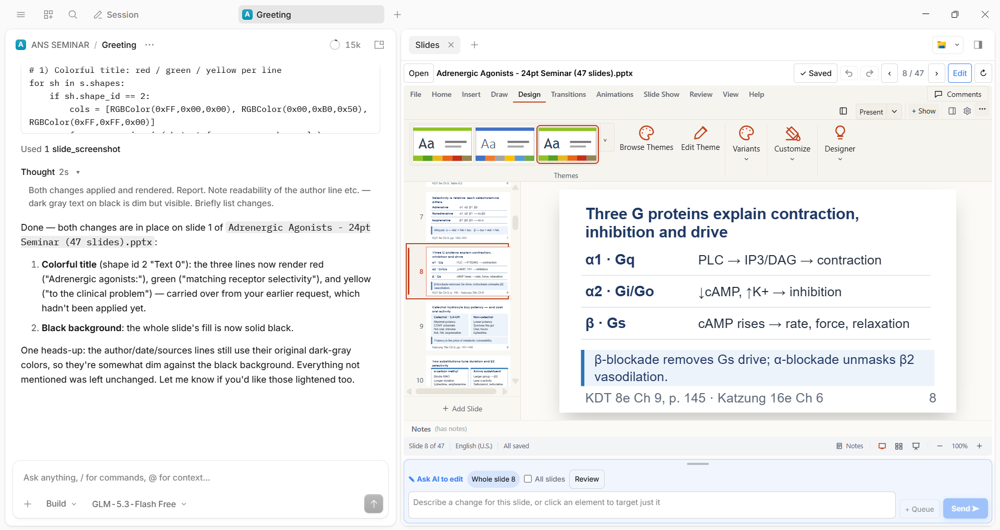
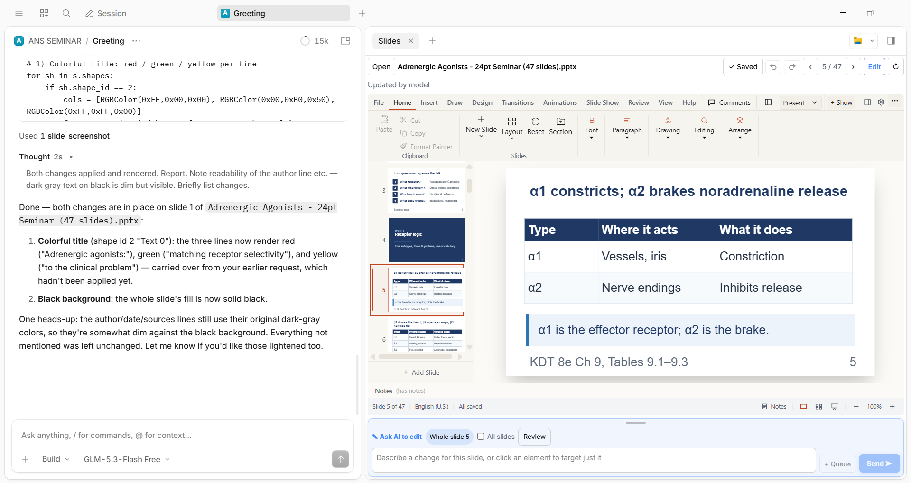

# OpenCode Slides Plugin

**Openslide skill** — a **Slides** side panel for the [OpenCode](https://opencode.ai) desktop app (2.2+), built on its
experimental `gui-experimental` plugin API. View and edit a PowerPoint deck next to your session, comment on individual
elements, and send them to the model — and let the model take screenshots of slides itself.





## What you get

- **A real, editable deck in the panel.** Slides render in the browser with
  [pptx-react-viewer](https://www.npmjs.com/package/pptx-react-viewer) (Apache-2.0) — no LibreOffice round trip.
  The panel shows just the slide; **Edit** brings back the full PowerPoint-style editor: ribbon (Home, Insert, Draw,
  Design, Transitions, Animations, Slide Show, Review, View, Help), thumbnails, notes, find/replace, themes and more.
  Changes autosave to the `.pptx` about a second after you stop.
- **Undo / redo arrows** in the header, and a clickable **Saved / Unsaved** button (also **Ctrl+S**). Reload (↻)
  saves pending edits first, so nothing is lost.
- **PowerPoint shortcuts**: Ctrl+Z / Ctrl+Y, Ctrl+C / X / V, Ctrl+D, Ctrl+M (new slide), Ctrl+B / I / U, Ctrl+L / E / R / J,
  Ctrl+[ and Ctrl+] (font size), Delete, arrows, PageUp / PageDown, F5 (start show), Ctrl+P (print),
  Ctrl+Home / End. They work from the panel as well as from inside the slide.
- **Ask AI to edit.** Click an element (or nothing = the whole slide), type what to change, **+ Queue** to collect
  several requests or **Send** to post one message to the current session with your comments (shape id, name, text) and
  PNGs of the commented slides (or all slides with **All slides**). **Review** asks the model to list problems on every
  slide. A small **Ask AI to edit** bubble appears next to a selected element and steps aside while you edit by hand.
  The bar is compact and resizable (drag the grip on its top edge).
- **The model can look at slides itself.** The plugin adds a `slide_screenshot` tool
  (`deck`: absolute path, optional when the deck is open in the panel; `slides`: 1-based list). An open panel
  answers in about a second; otherwise the file is rendered with LibreOffice.
- **Live reload.** When the model (or anything else) saves the deck, the panel reloads it; if you have unsaved edits
  it asks first.
- **Distinct animation icons**, full theme / variant previews, and a ribbon that is compact enough for a side panel.

## Requirements

- OpenCode Desktop **2.2 or newer** (the plugin GUI API is experimental and may change)
- A session model that accepts images (for the screenshots sent with your comments)
- Optional, for the `slide_screenshot` fallback when no panel is open: **LibreOffice**, and **Python 3** with
  `pip install python-pptx pymupdf`

## HOW TO INSTALL

The built files are committed, so there is no build step.

**macOS / Linux**

```bash
git clone https://github.com/aswanthwuhan/opencode-slides-plugin ~/.config/opencode/plugins/opencode-slides
```

**Windows (PowerShell)**

```powershell
git clone https://github.com/aswanthwuhan/opencode-slides-plugin "$env:USERPROFILE\.config\opencode\plugins\opencode-slides"
```

You can also clone anywhere and link it into that folder (`mklink /J` on Windows, `ln -s` elsewhere), or put it in a
project's `.opencode/plugins/` folder to enable it for that project only.

Then **fully quit and reopen OpenCode Desktop** (closing the window is not enough — the editor script is only loaded
when the panel is created).

To update later: `git pull` inside the plugin folder, then restart OpenCode.

### Optional plugin options

In your OpenCode 2 config, use a `plugins` entry of the form `{ "package": "<path>", "options": { … } }`:

| Option | Meaning |
|---|---|
| `python` | Path to the Python executable used for the LibreOffice fallback |
| `soffice` | Path to the LibreOffice executable |
| `pluginDir` | Where the plugin lives, if it is not in a standard plugins folder |

## AGENT INSTALL PROMPT

Paste this into an OpenCode session (or any coding agent with shell access) and let it do the install:

```text
Install the "OpenCode Slides Plugin" (Openslide skill) for OpenCode Desktop.

1. Clone https://github.com/aswanthwuhan/opencode-slides-plugin into OpenCode's global plugins folder:
   - macOS/Linux: ~/.config/opencode/plugins/opencode-slides
   - Windows: %USERPROFILE%\.config\opencode\plugins\opencode-slides
   If that folder already exists, run `git pull` inside it instead of cloning again.
2. Do NOT run npm install or any build — the built files (dist/viewer.js, gui-experimental.cjs) are already committed.
3. Verify the install: the folder must contain index.js, gui-experimental.cjs and dist/viewer.js. Run
   `node dev/main.test.mjs` inside the plugin folder and report whether it prints "ALL OK".
4. Optional (only if I ask for slide_screenshot to work without the panel open): check that LibreOffice and
   Python 3 are installed, and run `pip install python-pptx pymupdf`.
5. Tell me to fully quit and reopen OpenCode Desktop, then open the panel with: side-panel "+" > Slides > Open.
   Do not edit any other OpenCode configuration.
```

## HOW TO ACTIVATE IN OPENCODE

1. Fully quit and reopen **OpenCode Desktop** after installing.
2. Open a session (any project).
3. In the right side panel, click **+** (new tab) and choose **Slides**.
4. Click **Open** and pick a `.pptx` file. The deck appears in the panel.
5. Click **Edit** for the full editor, or just click an element and type in the **Ask AI to edit** bar to send a change
   request to the model.

If **Slides** is missing from the **+** menu, check that the plugin folder is
`~/.config/opencode/plugins/opencode-slides` (it must contain `index.js` and `gui-experimental.cjs`), then restart
OpenCode again, or use **Extensions › Plugins › Reload**. If the panel looks out of date after an update, quit and
reopen OpenCode so the new editor script is loaded.

## Develop

```bash
npm install --legacy-peer-deps   # viewer build deps (html2canvas-pro pinned via overrides)
npm run build:viewer             # viewer/app.jsx -> dist/viewer.js (~12 MB, loaded only when the panel opens)
bun run build                    # src/*.js + render/deck.py -> gui-experimental.cjs
node dev/main.test.mjs           # main process: render, watch, read/write, self-write suppression
node dev/bundle.test.cjs "$(pwd)/dev/sample.pptx"   # loads gui-experimental.cjs like the desktop host does (absolute path)
node dev/tool.test.mjs dev/sample.pptx              # slide_screenshot tool (LibreOffice fallback)
```

Browser test pages (serve this folder over http, for example `python -m http.server 8765`):
`dev/full.html` (real viewer in the real panel shell; add `?w=1250` for the panel width), `dev/viewer.html`
(viewer API), `dev/harness.html` (panel shell with a mock viewer).

| File | Role |
|---|---|
| `index.js` | Server half: the `slide_screenshot` tool |
| `src/gui.js` | Panel registration, prompts to the model, screenshot routing |
| `src/view.js` | Panel shell (header, viewer iframe, Ask AI bar, autosave, shortcuts) |
| `viewer/app.jsx` → `dist/viewer.js` | Viewer/editor running inside the iframe, plus the compact-ribbon CSS |
| `viewer/anim-icons.js` | Per-animation icons for the Animations gallery |
| `src/main.js`, `src/files.js`, `src/render.js` | Desktop main process: read/write/watch decks, LibreOffice render |
| `src/prompt.js`, `src/ipc.js`, `src/rpc.js` | Message builder and window/main/server contracts |
| `render/deck.py` | `.pptx` → PNGs + shape boxes (LibreOffice + python-pptx + PyMuPDF) |

## License

MIT — see [LICENSE](LICENSE). `dist/viewer.js` bundles third-party packages under their own licenses; see
[THIRD_PARTY_NOTICES.md](THIRD_PARTY_NOTICES.md).
